# 🔍 Wireshark SOC Lab – Network Traffic Analysis & Investigation

<div align="center">

**A Practical Approach to Network Traffic Analysis, Packet Inspection, and Security Investigation**

<br>


</div>

---

## 📌 Project Overview

This project documents my hands-on experience analysing network traffic using Wireshark as part of a practical SOC training exercise.

The lab involved investigating pre-prepared PCAP (Packet Capture) files to understand network communication, identify suspicious activities, reconstruct conversations, and examine potential security weaknesses.

Rather than generating network traffic or performing live packet captures, I worked with existing packet capture files and used Wireshark's analysis features to investigate recorded network activities.

The exercises introduced practical approaches to network investigation and demonstrated how packet-level evidence can help security analysts understand suspicious network behaviour.

## 🎯 Objectives

- Understand how to analyse network traffic using Wireshark.
- Identify suspicious IP addresses and communication patterns.
- Examine TCP conversations and interpret TCP flags.
- Reconstruct conversations using the Follow TCP Stream feature.
- Identify web pages accessed through captured HTTP traffic.
- Discover hidden information within HTML source content.
- Identify downloaded files through HTTP requests.
- Identify exposed credentials in unencrypted HTTP traffic.
- Understand how brute-force activity can be investigated through packet captures.
- Explore VoIP traffic and call reconstruction.

## 🛡️ Purpose of the Lab

Network traffic analysis is an important part of Security Operations Centre (SOC) activities and digital forensics.

Security analysts examine network traffic to identify suspicious connections, investigate potential attacks, understand communication between devices, and detect possible security weaknesses.

This lab provided an opportunity to apply these concepts through practical packet analysis.

## ⚙️ Lab Environment

| Component | Description |
|---|---|
| Analysis Tool | Wireshark |
| Evidence Source | Pre-prepared PCAP files |
| Investigation Type | Network Traffic Analysis |
| Approach | Offline packet analysis |
| Training Environment | NetworkWalks |

> **Note:** All investigations were conducted using previously captured network traffic. No live traffic generation or packet capture was performed during these exercises. All credentials and conversations shown are lab-generated sample data.

---

## 🔎 Investigation 1: Identifying the Attacker's IP Address

### 📖 Scenario

A staff member reported unusual network activity involving the company's web server.

The security team needed to investigate the available network traffic to identify the suspected source of the activity, determine the target system, examine the ports involved, and understand the possible nature of the activity.

### 🎯 Investigation Objectives

- Identify the suspected source IP address.
- Identify the target IP address.
- Examine the communication ports involved.
- Investigate the pattern of network requests.
- Determine the likely type of activity.

### 🧪 Investigation Procedure

**1. Examining Network Conversations**

I started by navigating to:

`Statistics → Conversations`

This feature provided an overview of communication between different endpoints in the captured traffic.

I examined the IP conversations and compared their packet volumes to identify unusual communication patterns.

One IP address stood out because it was responsible for a significantly higher volume of packets.

**2. Identifying the Suspected Source and Target**

Based on the conversation statistics and observed traffic pattern, I identified:

| Parameter | Observation |
|---|---|
| Suspected Source IP | `192.168.10.66` |
| Target IP | `192.168.10.20` |
| Activity | Multiple destination ports probed |
| Approximate Ports Probed | 40 |
| Reported Port Results | 3 open, 37 blocked |

The source IP consistently communicated from a source port while attempting connections to multiple destination ports on the target system.

**3. Analysing TCP Flags**

During the investigation, I examined TCP flags to better understand the connection attempts and responses.

Some of the important TCP flags I learned about include:

| TCP Flag | Meaning |
|---|---|
| SYN | Initiates a TCP connection. |
| ACK | Acknowledges received TCP data or a connection message. |
| FIN | Indicates a graceful connection termination. |
| RST | Resets or abruptly terminates a TCP connection. |

I also learned how the TCP three-way handshake works:

1. **SYN:** The client requests a connection.
2. **SYN-ACK:** The server acknowledges the request and responds.
3. **ACK:** The client acknowledges the response, completing the handshake.

Understanding these flags helped me interpret connection attempts and distinguish between different TCP communication patterns.

### 📊 Investigation Findings

The traffic showed a pattern of one source IP attempting to communicate with multiple destination ports on a target system.

This behaviour was consistent with TCP port scanning or network reconnaissance, where an individual or automated tool probes available ports to discover accessible services.

The investigation identified `192.168.10.66` as the suspected source and `192.168.10.20` as the target.

However, packet volume alone does not prove malicious activity. The traffic pattern and TCP responses must be considered together before making a definitive attribution.

### 📸 Evidence & Screenshots

**Lab Scenario – Identify the Attacker's IP**

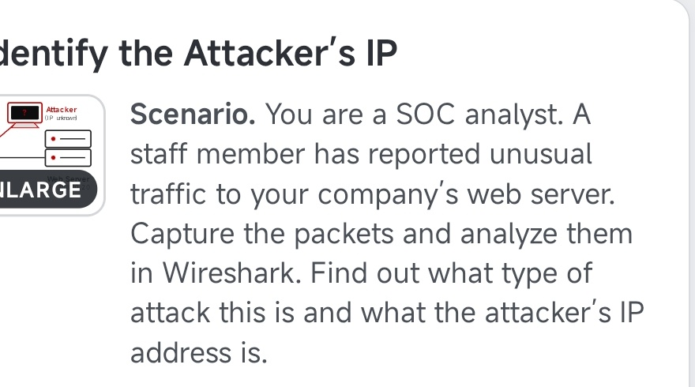

**Lab Result – 100%**

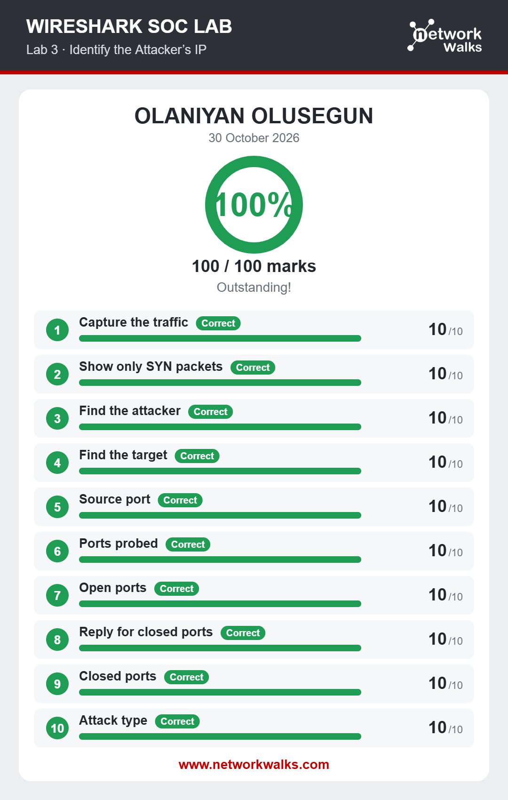

### 💡 What I Learned

- How to use Wireshark's Conversations feature to examine communication between network endpoints.
- How packet volumes can help identify unusual communication patterns.
- The difference between source ports and destination ports.
- How TCP flags help explain connection behaviour.
- How multiple connection attempts across different ports may indicate port scanning.
- Why network evidence should be correlated before drawing conclusions.

---

## 🔎 Investigation 2: Following TCP Streams – Reconstructing Internal Conversations

### 📖 Scenario

Employees within a company used an internal chat application to communicate with one another.

The investigation required examining captured network traffic to determine whether conversations between employees could be reconstructed.

The objective was to identify the communicating devices or users and recover the contents of their conversations.

### 🎯 Investigation Objectives

- Identify communication between the devices.
- Reconstruct TCP conversations.
- Identify the participants involved.
- Recover the contents of exchanged messages.
- Understand the security implications of exposed internal communications.

### 🧪 Investigation Procedure

**1. Identifying Relevant TCP Traffic**

I examined the captured packets to identify TCP communication associated with the internal chat application.

After identifying a relevant communication stream, I selected a packet and used Wireshark's **Follow TCP Stream** feature.

**2. Reconstructing the Conversation**

The Follow TCP Stream feature reconstructed the communication exchanged between the two endpoints.

This made it possible to view the conversation in a more readable format instead of examining individual packets separately.

Through this process, I was able to recover the names of the participants and the text messages exchanged between them.

**3. Examining the Recovered Messages**

The messages were readable because the communication was transmitted in plain text rather than being adequately encrypted.

The reconstructed conversation revealed the following exchange:

```
Office Chat v1.2

Hi, this is Ali from Accounts. I cannot open the shared drive.

Hello Ali, this is Sara from IT. Which drive is it?

The Finance drive.

OK, I reset your access. Your temporary password is Tiger#4821.

Thanks. Do you also have the guest Wi-Fi password for our visitors?

Yes. Guest Wi-Fi password: BlueHarbor77.

Perfect. Thank you Sara, bye.

Bye Ali. Your ticket number is HD-20931.
```

This demonstrated how someone with access to captured network traffic could potentially inspect private communications and recover sensitive information when an application does not properly protect its data in transit.

### 📊 Investigation Findings

The investigation successfully reconstructed a conversation between two devices communicating through the company's internal chat application.

The recovered traffic exposed:

- The names of the participants.
- The messages exchanged between them.
- A temporary account password.
- A guest Wi-Fi password.
- A help desk ticket reference.

The observation suggested that the chat application's communication was not adequately protected against network-level inspection.

### 📸 Evidence & Screenshots

**Lab Scenario – Follow TCP Stream**

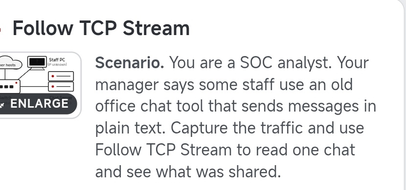

**Follow TCP Stream – Reconstructed Internal Conversation**

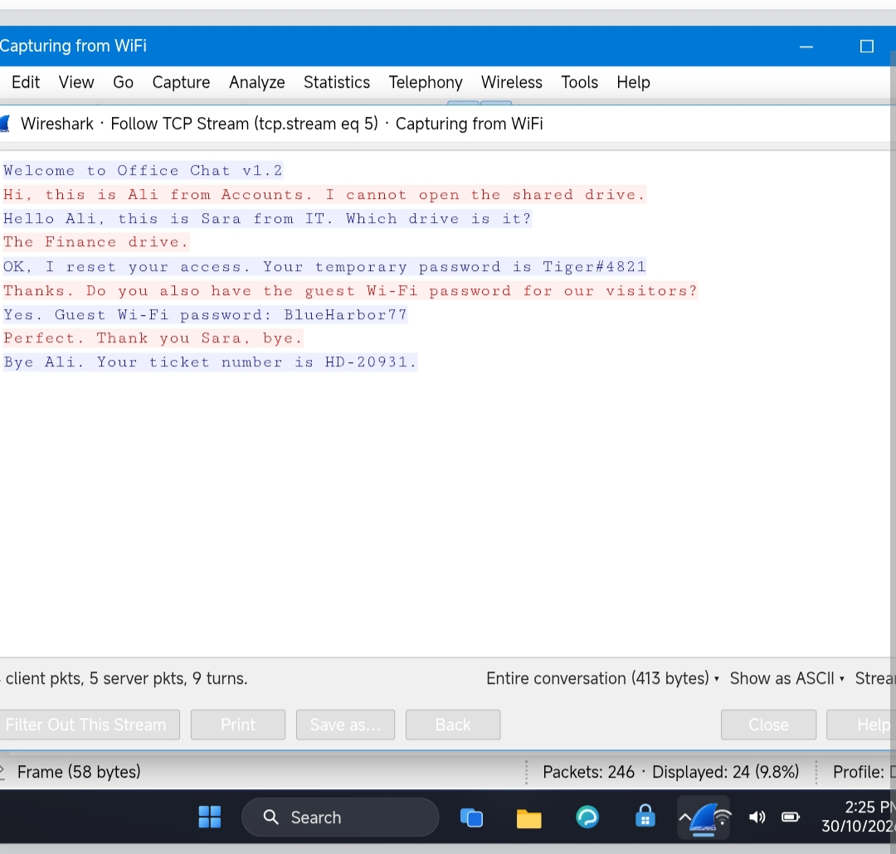

**Lab Result – 90%**

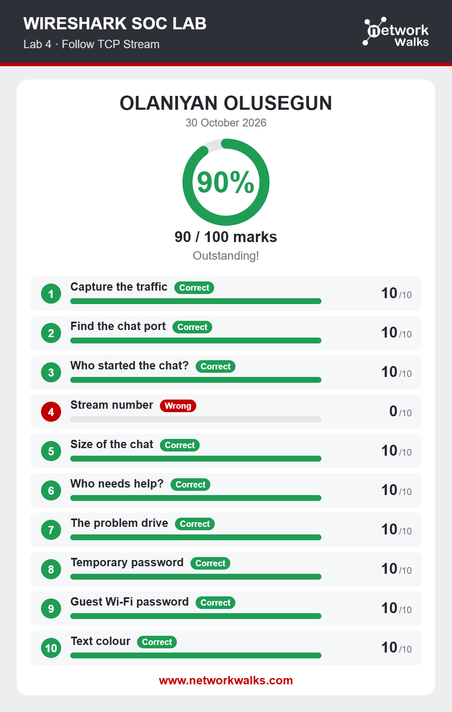

### 💡 What I Learned

- How to use Wireshark's Follow TCP Stream feature.
- How individual packets can be reconstructed into a readable communication stream.
- How unencrypted network communication can expose sensitive information.
- Why internal network communication should not automatically be considered secure.
- The importance of encryption in protecting information transmitted across networks.

### 🔐 Security Implications

Encryption helps protect information while it travels between communicating systems.

When applications transmit sensitive information in plain text, an individual with access to the relevant network traffic may be able to inspect that information.

This investigation reinforced the importance of using secure communication protocols and properly protecting sensitive internal communications.

---

## 🔎 Investigation 3: Following TCP Streams – Discovering Visited Web Pages and Hidden Text

### 📖 Scenario

A staff member browsed the company's intranet. An administrator suspected that someone had left a secret message inside one of the web pages.

The task was to examine the captured network traffic, identify the web pages visited by the staff member, locate the page containing the hidden information, and use Wireshark's Follow TCP Stream feature to recover the text.

### 🎯 Investigation Objectives

- Identify web pages accessed by the staff member.
- Extract a list of potentially visited pages from the captured traffic.
- Locate the specific `staff.html` page.
- Examine HTTP requests and responses.
- Discover hidden text embedded within an HTML comment.
- Identify downloaded files through HTTP request analysis.

### 🧪 Investigation Procedure

**1. Identifying the Visited Web Pages Using HTTP GET Requests**

I began by examining HTTP GET requests within the captured traffic.

The HTTP GET method is used by clients to request resources from a web server, such as HTML pages, images, and downloadable files.

By examining these requests, I was able to identify a list of web pages that the staff member had accessed or attempted to access through the company's intranet.

This helped narrow down the investigation and identify the particular page of interest: `staff.html`.

**2. Locating the Hidden Text in staff.html**

After identifying `staff.html`, I examined the relevant HTTP communication to inspect the content returned by the web server.

During the investigation, I discovered that the page contained hidden text embedded inside an HTML comment.

HTML comments are written using the following syntax:

```html
<!-- This is a hidden HTML comment -->
```

Text placed inside an HTML comment is not normally displayed as part of the visible web page when viewed in a browser.

However, the comment can still exist in the HTML source code and may be exposed when the page content is transmitted over an unencrypted HTTP connection.

By inspecting the captured traffic, I was able to discover the hidden text that would not have been visible on the main page.

**3. Identifying Downloaded Files**

I also used the following Wireshark display filter:

```
http.request.uri contains "downloads"
```

This filter helped me identify HTTP requests whose request URI contained the word "downloads".

By examining the matching requests, I was able to investigate the files requested for download through the captured network traffic.

This provided another way to understand the staff member's browsing and download activity.

**4. Following the TCP Stream**

I used Wireshark's Follow TCP Stream feature to reconstruct the relevant communication and inspect the exchanged content.

This made it easier to examine the HTTP data and locate the hidden information within the page content.

### 📊 Investigation Findings

The investigation successfully identified `staff.html` among the pages accessed through the captured traffic.

Further examination revealed hidden text embedded inside an HTML comment.

Although the comment was not visible on the rendered web page, its contents could be discovered by inspecting the HTML source transmitted through the network.

I also used the `http.request.uri contains "downloads"` filter to identify requests associated with downloaded files.

The investigation demonstrated that captured network traffic can reveal more than the visible browsing experience. It can also expose underlying web requests, page contents, and information that may not be displayed directly in a browser.

### 📸 Evidence & Screenshots

**Lab Scenario – Follow TCP Stream, Part 2**

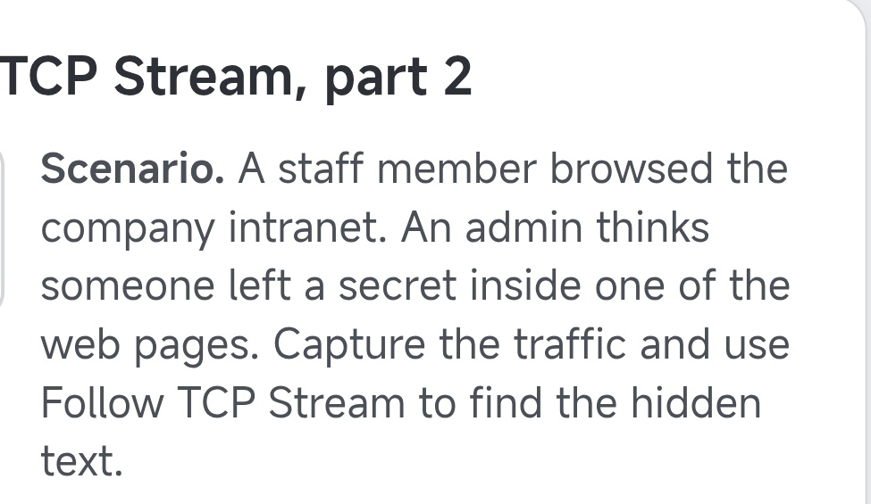

**Lab Result – 90%**

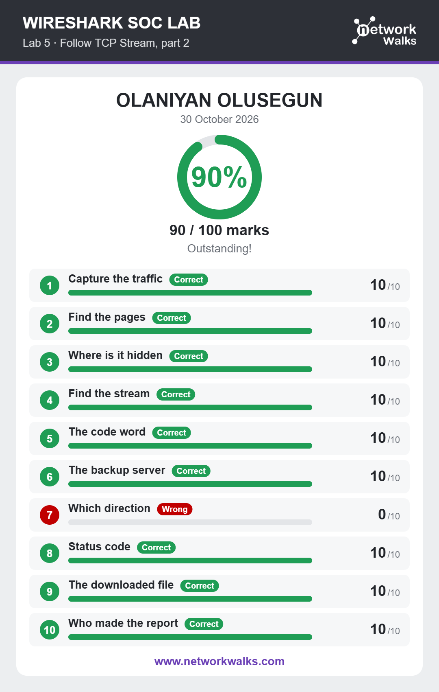

### 💡 What I Learned

- How HTTP GET requests can help identify pages requested by a user.
- How to extract visited page information from captured network traffic.
- How to identify a specific web page, such as `staff.html`, during an investigation.
- How HTML comments can contain information that is not displayed on a web page.
- How to discover hidden text by inspecting the HTML content transmitted over a network.
- How to use Wireshark's `http.request.uri contains "downloads"` display filter.
- How to identify HTTP requests associated with downloaded files.
- How to use Follow TCP Stream to reconstruct and inspect network communication.

---

## 🔎 Investigation 4: Identifying Plain-Text HTTP Credentials

### 📖 Scenario

An old staff portal was still running on plain HTTP.

The task was to examine the captured traffic and find out what a person could read from a sign-in that is not encrypted.

### 🎯 Investigation Objectives

- Examine HTTP traffic associated with the staff portal sign-in.
- Identify credentials transmitted without encryption.
- Understand the risks of exposing authentication information over HTTP.
- Understand why HTTPS is needed to protect login data.

### 🧪 Investigation Procedure

**1. Filtering for HTTP Traffic**

I started by applying the `http` display filter so that only HTTP traffic from the staff portal was shown.

**2. Locating the Login Request with the POST Method**

Login forms send the details a user types to the server using the HTTP POST method, so I looked for POST requests in the filtered traffic. This led me to the packet for the website's login page.

**3. Inspecting the Login Packet**

I inspected the login packet and was able to extract the user's login credentials directly from the packet data.

**4. Reviewing the Login Attempts**

I then checked the login attempts made from the same host. The user tried to sign in twice: the first attempt failed and the second succeeded.

### 📊 Investigation Findings

| Parameter | Observation |
|---|---|
| Protocol | HTTP (not encrypted) |
| Request Method | POST to `/login` |
| User | `farhan.k` |
| Source IP | `192.168.10.45` |
| Login Attempts | 2 (first failed, second succeeded) |
| Password Sent in Plain Text | `Mango#2026` (lab sample data) |
| Recommended Fix | Use HTTPS |

The portal's sign-in was sent over plain HTTP, so the login details travelled across the network unencrypted. By filtering for HTTP and finding the POST request to `/login`, I was able to open the login packet and read the submitted credentials in plain text.

The fix is to serve the portal over HTTPS, so that login data is encrypted in transit.

This shows that a server that does not use HTTPS gives no protection to the information users send to it.

> **Note:** The credentials in this lab are sample data created for training. Real credentials should never be published.

### 📸 Evidence & Screenshots

**Lab Scenario – HTTP Plain Text Credentials**

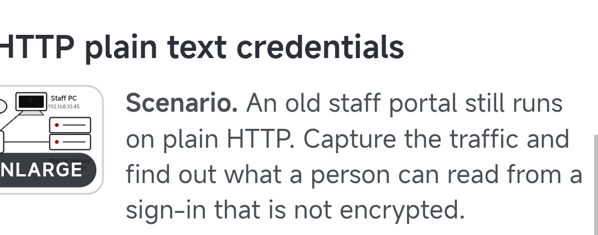

**Lab Result – 100%**

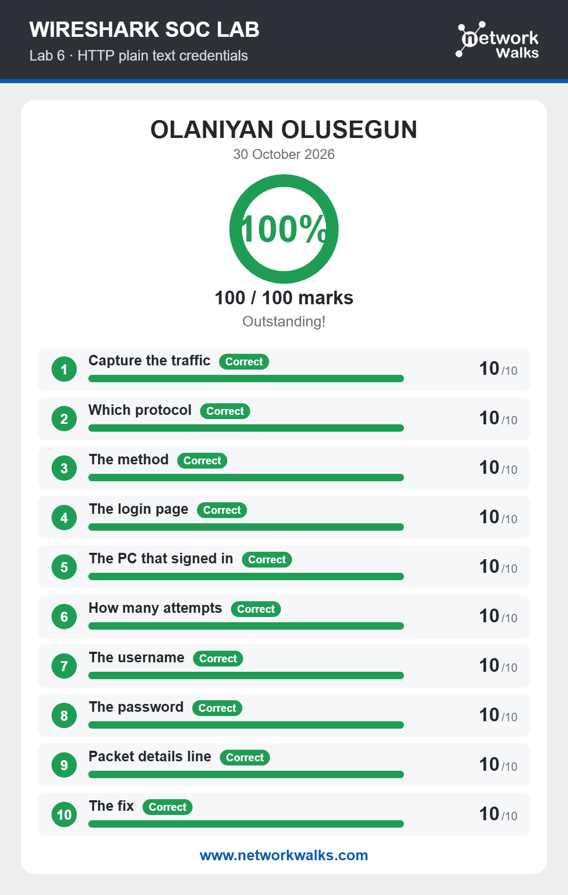

### 💡 What I Learned

- A web server that uses plain HTTP does not protect the data sent to it.
- Attackers can extract sensitive credentials, such as emails and passwords, from unencrypted HTTP traffic using Wireshark and packet capture analysis.
- HTTPS is much more secure than HTTP because it encrypts data in transit.
- Websites must be properly secured with HTTPS, especially on pages that handle logins.

---

## 🔎 Investigation 5: Detecting Brute-Force Activity

### 📖 Scenario

An FTP server owner reported many failed sign-ins within the last few minutes.

The task was to examine the captured traffic, find who was guessing passwords, and determine whether the attacker managed to get in.

### 🎯 Investigation Objectives

- Identify the source of the repeated failed sign-in attempts.
- Recognise network patterns that indicate a brute-force attack.
- Determine whether the attacker eventually gained access.

### 🧪 Investigation Procedure

I examined the captured FTP traffic to look for repeated authentication attempts against the server, counted the attempts made, and checked whether any of them succeeded.

### 📊 Investigation Findings

| Parameter | Observation |
|---|---|
| Attacker IP | `192.168.10.66` |
| Target | FTP server `192.168.10.20` (port 21) |
| Targeted Account | `admin` |
| Failed Logins | 24 (FTP response code 530) |
| Successful Logins | 1 (FTP response code 230) |
| Password Found | `Sunshine99` (lab sample data) |
| Attack Type | Brute force |

The traffic showed repeated sign-in attempts against the FTP server, consistent with a brute-force attack, where an attacker tries many passwords until one works.

The attacker made 24 failed attempts against the `admin` account, each answered with code 530 (login failed). The attempt that followed was answered with code 230 (login successful), confirming the attacker got in. Only one successful login was recorded.

This means the server owner's report of failed sign-ins was not just a nuisance: the account had actually been compromised.

### 📸 Evidence & Screenshots

**Lab Scenario – Brute Force Catch**

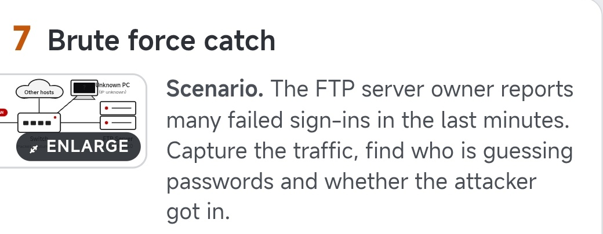

**Lab Result – 100%**

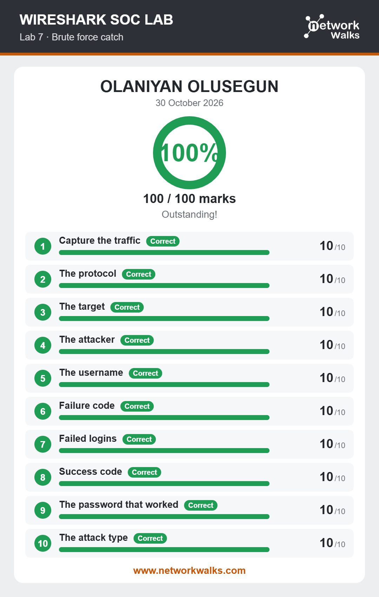

### 💡 What I Learned

- How attackers use brute-force attacks to force their way into a website or account by trying many passwords until they find the correct one.
- How repeated authentication attempts show up in captured network traffic.
- Why failed sign-in patterns are an important signal for defenders to watch.

---

## 🔎 Investigation 6: VoIP Call Replay

### 📖 Scenario

A phone call was made through the company's VoIP system.

The task was to examine the captured traffic, find the call, and play it back to learn what was said.

### 🎯 Investigation Objectives

- Identify the VoIP call within the captured traffic.
- Understand how the call was set up and how its audio was carried.
- Reconstruct and replay the call.

### 🧪 Investigation Procedure

**1. Identifying the Call**

I selected the call in the captured traffic, which showed me the communication between the source IP and the target IP.

**2. Reading the Call Details**

From the call information, I was able to read:

- The time the call was initiated.
- The time it rang.
- The time it was accepted.
- The time it ended.
- The total duration of the call.

**3. Replaying the Call**

I used Wireshark's **Telephony** feature and followed the **SIP stream** to replay the call and hear what was said.

### 📊 Investigation Findings

| Parameter | Observation |
|---|---|
| Call Setup Protocol | SIP (INVITE, 180 Ringing, 200 OK, ACK, BYE) |
| Voice Transport | RTP, codec G.711 PCMU |
| Caller | Ali Raza (extension 101) |
| Answered By | Sara (extension 202) |
| Information Spoken in Clear | Card number ending in 2394, expiry 09/28 (lab sample data) |
| Recommended Fix | Encrypt calls with SRTP, and use TLS for SIP |

The captured traffic contained a VoIP call that could be identified and reconstructed from the packets. The SIP messages showed the full life of the call: the caller sent an INVITE, the phone rang (180 Ringing), the call was answered (200 OK), the caller acknowledged (ACK), and the call ended with a BYE. The voice itself travelled over RTP using the G.711 PCMU codec.

I was able to establish who was communicating, build a timeline of the call from start to finish, and replay it. The replayed call revealed payment card details spoken in clear.

Because the call was not protected, its content could be replayed by anyone with access to the capture. The fix is to encrypt the voice with SRTP and protect the SIP signalling with TLS.

### 📸 Evidence & Screenshots

**Lab Scenario – VoIP Call Replay**

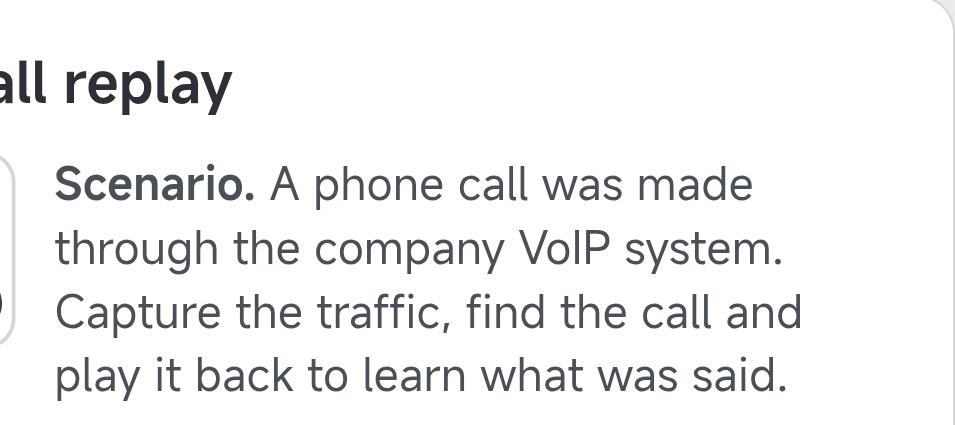

**Lab Result – 90%**

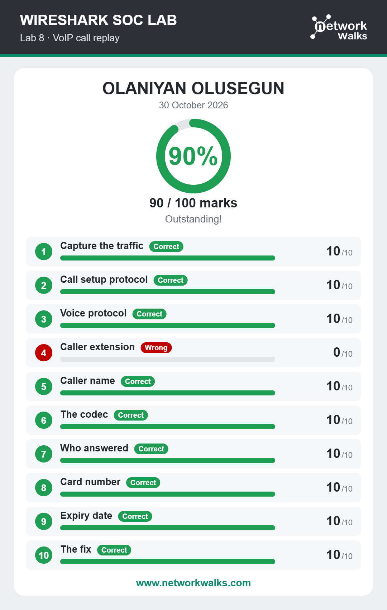

### 💡 What I Learned

- **VoIP (Voice over Internet Protocol)** carries voice calls across a network.
- **SIP (Session Initiation Protocol)** is used to initiate and manage calls over a network.
- **RTP (Real-time Transport Protocol)** is used to transfer the call's audio (media).
- How to read call conversations in Wireshark through SIP streams.
- To secure calls, **SRTP (Secure Real-time Transport Protocol)** should be implemented so the media is encrypted, with **TLS** protecting the SIP signalling.
- Sensitive details, such as card information, can be recovered from an unencrypted call.

---

## 🧠 Key Takeaways

This lab helped me understand that network traffic contains valuable information that can support security investigations.

Some of my major takeaways include:

- Network conversations can reveal unusual communication patterns.
- TCP flags provide useful information about connection behaviour.
- Follow TCP Stream can help reconstruct application-level communication.
- HTTP GET requests can reveal resources requested by users.
- HTML comments can contain information that is not visible on rendered web pages.
- HTTP request filters can help identify file download activity.
- Unencrypted protocols such as HTTP can expose sensitive information, including login credentials. HTTPS should always be used.
- Repeated authentication attempts may indicate brute-force activity.
- VoIP calls rely on SIP for call setup and RTP for audio, and SRTP is needed to keep calls secure.
- PCAP files can serve as valuable sources of evidence during network investigations.

Most importantly, I learned that effective network analysis requires more than identifying individual packets. It involves understanding communication patterns, interpreting protocols, examining application-level data, and correlating observations before reaching conclusions.

## 🛠️ Tools & Technologies

- **Wireshark:** Network protocol analyser used to inspect and investigate captured traffic.
- **PCAP Files:** Pre-existing packet capture files used as investigation evidence.
- **TCP/IP:** Network communication protocols examined during the exercises.
- **HTTP / HTTPS:** Application-layer protocols examined during traffic analysis, including the risks of plain HTTP.
- **HTTP GET:** HTTP method used to identify requested web resources.
- **FTP:** File transfer protocol examined while investigating brute-force activity.
- **Wireshark Display Filters:** Used to narrow down relevant packets during investigations.
- **HTML:** Markup language examined to identify hidden information in HTML comments.
- **VoIP, SIP, RTP and SRTP:** Voice over IP, Session Initiation Protocol, Real-time Transport Protocol, and Secure RTP, explored during call analysis.

## 🔐 Ethical Considerations

Network traffic analysis can expose sensitive information, including credentials and private communications.

All practical investigations should be conducted using authorised lab environments, approved packet captures, and evidence that the analyst has permission to examine.

The techniques explored in this project are intended for cybersecurity education, defensive security, and authorised investigations.

---

## 👤 Author

**Oluwasegun Olamilekan (Rey)**

Cybersecurity Learner | Digital Forensics & Incident Response (DFIR) Enthusiast

- LinkedIn: [Connect with me](https://www.linkedin.com/in/oluwasegun-olamilekan-60a515244/)
- GitHub: [Explore my repositories](https://github.com/)

---

<div align="center">

**Learn. Investigate. Grow.**

*Building practical cybersecurity skills, one investigation at a time.*

</div>
